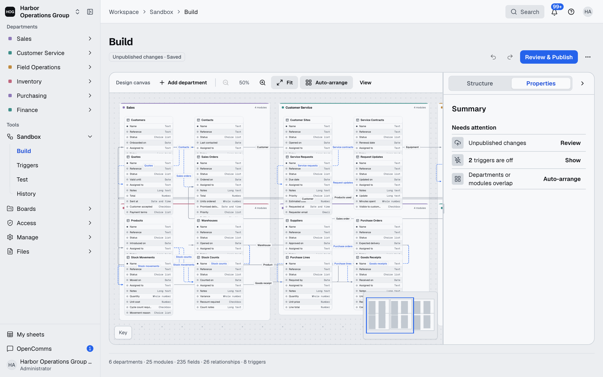

  <picture>
    <source media="(prefers-color-scheme: dark)" srcset=".github/assets/banner-dark.svg">
    
  </picture>

Slate Operations turns the drawing into one system that your organization's people use every day. You install it on one Windows PC in your office.

  
  
  
  

*The Sandbox, shown with sample data.*

## What it does

- **Sandbox.** Lay out your departments, their tables and the links between them on a canvas. Try the design with test values that make no real records, then publish it.
- **Records.** Search, filter and sort each department's records, show them as a table, grid or gallery, save views, and export to CSV or Excel.
- **Sheets.** Add your own tables for notes, checklists, costs or plans to a record. Start from a blank sheet, a CSV file or an Excel file.
- **Boards.** Posts, a calendar, Kanban and Gantt for the whole organization, for each department and for each project.
- **Messages.** Channels, direct messages and group messages, with threads, files and records inside messages.
- **Access.** Administrators, members and guests. Groups give each department Read, Write or Manage access. Two-step verification and sign-in history are included.
- **Backups and updates.** Encrypted backups every night to a drive that you choose, a one-button restore, and an update that goes back to the old version by itself if it fails.

Messages, dashboards, reports, automations, the Gantt view and the audit viewer need Office or Headquarters (see [Editions](#editions)).

## Install

Slate Operations runs on one Windows 11 Pro, Enterprise or Education PC (version 22H2 or later) with a 64-bit Intel or AMD processor, virtualization turned on, 16 GB of memory and 15 GB of free disk space. Phones and other PCs on your office network open it in a browser. Your data stays on that PC and on your backup drive.

1. Download `SlateOpsSetup-<version>.exe` from the [latest release](https://github.com/jayeuse/slateops/releases/latest).
2. Follow the [quick start](docs/customer/quick-start.md).

The setup program is not code-signed yet. Windows SmartScreen shows a warning: select **More info**, then **Run anyway**. A PC with Smart App Control turned on blocks the setup program. Each release has checksums and a signed manifest, and its release notes show how to check them.

## Editions

Every installation starts as **Desk**, the free edition, with limits on people, departments and records. A license file unlocks **Office** or **Headquarters**, and it works with no internet connection.

Office and Headquarters add the parts named above and raise or remove the limits. [Editions and license files](docs/customer/editions-and-license.md) gives the limits and how to get a license file.

## Documentation

- [Quick start](docs/customer/quick-start.md): prepare the server PC and install.
- [Administrator guide](docs/customer/administrator-guide.md): set up and run the installation.
- [User guide](docs/customer/user-guide.md): everyday use for every person.
- [Customer documents](docs/customer/README.md): editions, getting help, and data and privacy.
- [Changelog](CHANGELOG.md): what changed in each release.
- [Documentation index](docs/README.md): specs, plans and the release process.
- [Architecture](docs/architecture/README.md): how Slate Operations is built, with source paths.

## Contributing

To run Slate Operations from source or to change it, read [CONTRIBUTING.md](CONTRIBUTING.md).

## Security

Report a vulnerability privately, as [SECURITY.md](SECURITY.md) describes. Do not open a public issue.

## License

Slate Operations is licensed under the [Elastic License 2.0](LICENSE). You can use it for your own organization, and you can copy, share and change it. You cannot offer it to other people as a hosted or managed service, and you cannot go around the license file check. [Editions and license files](docs/customer/editions-and-license.md) explains how this applies to the editions.
